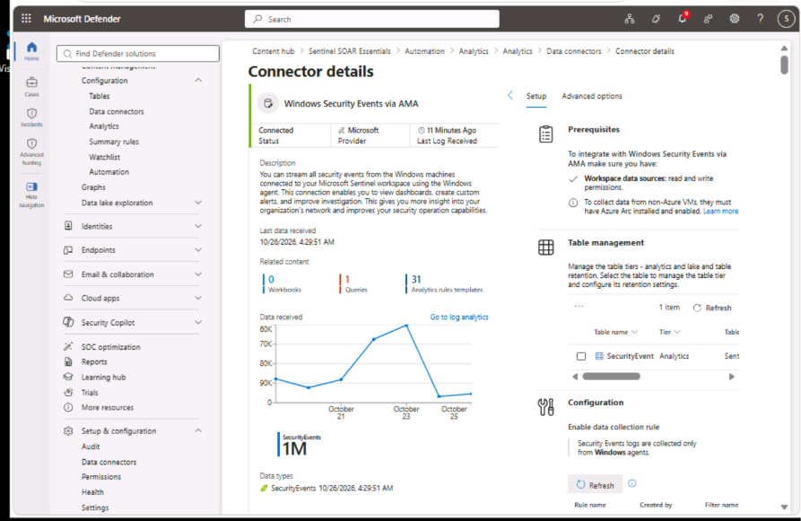
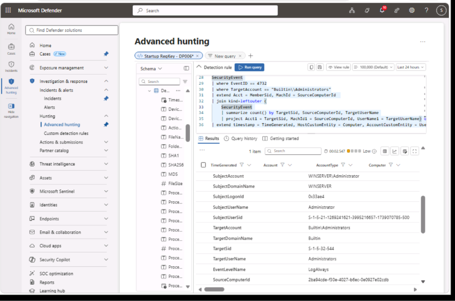
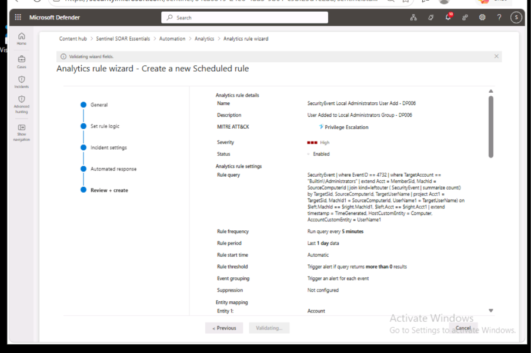
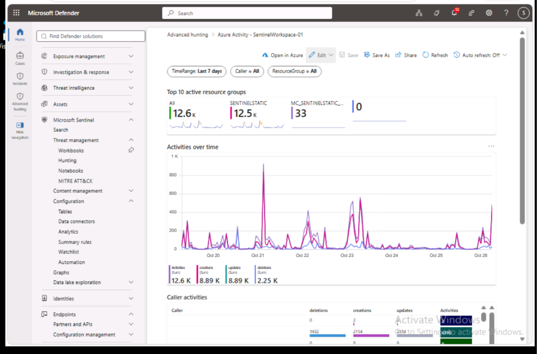

# Project: Cloud-Native SIEM Engineering and SOAR Automation

## Project Overview
This repository details my work architecting, deploying, and operationalizing Microsoft Sentinel as a centralized SIEM and SOAR platform. The focus of this project was ingesting multi-platform telemetry, engineering custom detection rules using KQL, automating incident response workflows, and managing detection content through Azure DevOps.

## Objectives
* Ingest security telemetry from diverse sources, including Azure Activity, Microsoft Defender XDR, and hybrid Windows and Linux environments.
* Develop and tune custom KQL analytics rules to detect specific MITRE ATT&CK techniques.
* Deploy Advanced Security Information Model (ASIM) parsers to normalize log data.
* Automate incident response actions using Logic App playbooks and Sentinel Automation Rules.
* Visualize security posture through custom Workbooks and manage detection rules via CI/CD principles.

## Tools and Technologies
* Microsoft Sentinel and Microsoft Defender XDR
* Kusto Query Language (KQL)
* Azure Monitor Agent (AMA) and Azure Arc
* Azure Logic Apps (Playbooks)
* Azure DevOps (Repositories)

## Prerequisites
* Azure subscription with a pre-deployed Microsoft Sentinel workspace.
* Virtual machines representing hybrid environments (Azure Windows VM, on-premises Windows Server, Linux hosts).

## Implementation Phases

### Phase 1: Multi-Source Data Ingestion Architecture
1. **Cloud and XDR Integration**: Connected the Microsoft Defender for Cloud and Azure Activity data connectors via the Content Hub. This streams subscription-level security alerts and control plane operations directly into Sentinel.
2. **Hybrid Windows Onboarding**: Installed the Azure Arc agent on an on-premises Windows Server. I created a Data Collection Rule (DCR) using the Windows Security Events via AMA connector to forward all security events from both the Azure VM and the Arc-connected on-premises server to the Sentinel workspace.
3. **Linux Host Integration**: Connected two Linux hosts to broaden telemetry coverage. I configured the Common Event Format (CEF) via AMA connector for the first host, and the Syslog via AMA connector for the second. I created distinct DCRs to capture `LOG_WARNING` level events and above.
4. **Unified XDR Connection**: Linked the Microsoft Defender XDR tenant to the Sentinel workspace to unify alert data and enable cross-domain threat hunting.

  
*Caption: Microsoft Sentinel Content Hub showing active data connectors for Windows, Linux, and Azure Activity.*

### Phase 2: Custom Detection Engineering and Normalization
1. **KQL Threat Hunting**: Utilized Advanced Hunting to develop and test KQL queries. I used operators like `search`, `where`, `summarize`, `join`, and `mv-expand` to isolate anomalous behavior, such as distinct account logins and suspicious process executions.
2. **Persistence Detection Rule**: Engineered a custom scheduled analytics rule to detect registry modifications indicating persistence. The query filters `SecurityEvent` for Event ID 4688 where the process is `reg.exe` and the command line targets the `C:\temp` directory. I mapped the `Computer` and `SubjectUserName` fields to Host and Account entities for investigation graph compatibility.
3. **Privilege Escalation Detection Rule**: Developed a complex KQL query using a `leftouter` join to correlate Event ID 4732 (member added to security-enabled local group) with the corresponding user account name. This resolves the limitation of SID-only logging. I mapped the resolved username to the Account entity.
4. **ASIM Parser Deployment**: Explored and deployed the `_Im_RegistryEvent_MicrosoftWindowsEvent` ASIM function to normalize registry event data. This simplifies future cross-platform correlation and query writing.

*Caption: Custom KQL query utilizing a join operation to resolve a user SID to a readable username for Entity Mapping.*

### Phase 3: SOAR Automation and Incident Management
1. **Playbook Development**: Deployed the "Defender XDR Ransomware Playbook for SecOps Tasks" from the Sentinel SOAR Essentials Content Hub solution. I updated the Logic App designer to authenticate the Microsoft Sentinel incident connection.
2. **Automation Rules**: Created an automation rule triggered when an incident is created with specific MITRE ATT&CK tactics (Execution, Persistence, Command and Control). I configured the rule to automatically run the ransomware playbook and assign the incident to the Tier 2 analyst queue.
3. **Incident Investigation**: Investigated a triggered "Startup RegKey" incident. I managed the incident lifecycle by adding tags, assigning ownership, and utilizing the Investigation Graph to explore related alerts and timeline events for the compromised host. I classified the incident as a "True positive - suspicious activity" upon completion.

  
*Caption: Automation rule configuration triggering a Logic App playbook based on incident tactics.*

### Phase 4: Visualization and Content Management
1. **Custom Workbook Creation**: Built a custom Sentinel Workbook from scratch. I added a time chart visualization for `SecurityEvent` data and a grid view, applying custom width layouts and heatmap column rendering to improve data readability for SOC analysts.
2. **DevOps Repository Integration**: Exported a custom analytics rule to a JSON ARM template. I initialized an Azure DevOps repository, uploaded the JSON file, and configured the Sentinel Repositories feature to connect to the Azure DevOps main branch. This establishes a foundation for CI/CD management of detection content.

  
*Caption: Custom Microsoft Sentinel Workbook displaying security event visualizations with heatmap formatting.*

## Key Findings and Outcomes
* Demonstrated that Azure Arc and AMA can effectively unify telemetry from both cloud and on-premises assets into a single SIEM workspace.
* Improved the fidelity and actionability of generated alerts by writing multi-table KQL joins and configuring precise entity mapping.
* Reduced manual triage time by implementing Logic App playbooks triggered by automation rules, showcasing a practical understanding of SOAR principles.
* Validated the use of Azure DevOps for Sentinel content management, highlighting a mature approach to version control and deployment of detection rules.
